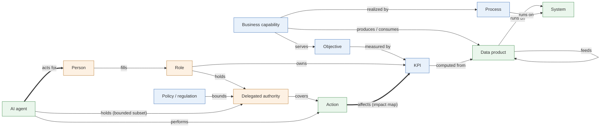

# Organizational meta-model v1 (draft for review)

The meta-model defines the 12 entity types from the white paper and how they relate. Customers fill it with their own objectives, roles, people, authority, agents, data and systems; it ships with the product and changes only through review.

Files:
- `ontology/veromesh-org.ttl`: the model (OWL)
- `ontology/shapes/veromesh-org-shapes.ttl`: the validation rules (SHACL)
- `ontology/examples/org-procure-to-pay.ttl`: a worked example, one value stream at a fictional company
- `ontology/tests/test_shapes.py`: 20 tests; each breaks the example one way and checks the right rule fires

## The model at a glance

Blue: business intent. Orange: people and authority. Green: agents and data. Ownership is drawn once (Role owns KPI) to keep the picture readable; roles also own capabilities, processes, policies, data products, systems and data elements.

The two thick arrows make the model organizational rather than semantic: **acts for** (borrowed authority) and **affects** (impact routed to the KPI's owner).

## Entity types

| Type | What it is | Key facts recorded | Usual source |
| --- | --- | --- | --- |
| Objective | An outcome the organization intends | name, KPIs measuring it | Strategy / OKR tools |
| KPI | A measure of progress toward objectives; used for routing, not as a target | definition, unit, one owning role, data products it is computed from | Metrics layer, performance tools |
| Policy, Regulation | An internal rule or external law | name, jurisdiction, what it bounds | GRC / policy library |
| Business capability | What the organization can do | owner, objectives served, parent capability, processes, data produced and consumed | Enterprise architecture tools |
| Process | A business process realizing a capability | owner, systems it runs on | Process repository |
| Person | A human filling roles; principal for agents | name, employee ID, email, roles, reporting line, nothing else | HR, identity |
| Role | A job role or position; ownership attaches here | name, who fills it, authority held | HR |
| Delegated authority | A grant to decide or act | holder, actions covered, capability scope, limit and currency, validity dates, delegated by, parent grant | ERP approval matrix, credentialing, credit authority |
| AI agent | Software that acts for exactly one person | principal, authority held, actions performed, data consumed, system | Agent registry |
| Action | A type of consequential action | process, KPIs and capabilities affected, materiality thresholds | Process owners |
| Data product | Governed, owned data with known producers and consumers | owner, system, lineage (feeds), elements, sensitivity, catalog URN | DataHub |
| System | An application or platform | business and technical owner, CMDB ID, criticality, lifecycle, regulatory scope | CMDB |

Two supporting types: **Impact** (attaches a materiality threshold to "action affects KPI") and **Business data element** (a business-level data item; physical columns bind to it).

## Validation rules

**Violations** reject the data. **Warnings** accept it and report the gap; warnings drive the coverage measures.

| Rule | Severity |
| --- | --- |
| An agent acts for exactly one person | Violation |
| An agent's authority is a bounded subset of an authority its principal holds, directly or through a role | Violation |
| A bounded subset never exceeds its parent: limit, currency, actions, validity dates, capability scope | Violation |
| An agent only performs actions one of its authorities covers | Violation |
| Each authority has exactly one holder and covers at least one action; a limit needs a currency; validity cannot end before it starts | Violation |
| Only role-relevant facts may be recorded about a person (closed shape: no performance data, no informal networks) | Violation |
| KPIs, capabilities and data products have at most one owning role | Violation |
| A critical data element has an owner, a steward and an authoritative source system | Violation |
| Sensitivity and data category use the controlled lists | Violation |
| Every impact with a threshold is also listed under "affects" | Violation |
| Missing owner, KPI, definition, employee ID, unfilled role, action with no impact map, KPI not traced to data, system without owners | Warning |

## Choices made in this draft

1. **Facts carry their time and source outside the model.** When someone started in a role, and which system said so, are recorded by the provenance layer (one named graph per source). Only validity intrinsic to the thing itself, a delegation's dates, is modeled here. This keeps the model small and makes every fact traceable the same way.
2. **Ownership always points to a Role, never a Person.** It survives staff changes, and routing goes to whoever fills the role today.
3. **Action is a type, not an event.** "Approve supplier invoice" is in the model; each approval an agent made is in the decision log.
4. **Authority can be held by a Role, a Person or an Agent.** Most grants sit on roles; personal grants exist (e.g. clinical privileges); agents only ever hold bounded subsets.
5. **Materiality is per action and KPI pair.** The same action can be minor for one KPI and material for another.
6. **Standards are aligned, not imported.** Person is a FOAF and PROV Person, Role is a W3C ORG Role, AI agent is a PROV software agent, acts-for is a kind of PROV acted-on-behalf-of, and data product is a DCAT resource. Tools that understand those standards can read our data; nothing is fetched at runtime.
7. **Industry specifics are subclasses.** A clinical privilege or a credit limit becomes a subclass of Delegated authority in an extension pack; the decision protocol treats it like any other authority.

## Questions for review

1. **Organizational units.** Departments and legal entities are not modeled. Add W3C ORG's organizational unit now (roles belong to units), or wait?
2. **Reporting lines.** The draft allows formal reporting lines (W3C ORG "reports to"). Keep them, or treat them as out of scope with the other people data?
3. **Approval chains.** Some authorities need a second approver above a limit. Model that as part of Delegated authority now, or leave it to the policy engine?
4. **Who may delegate.** The draft records who delegated a grant but does not check that they were allowed to. Add a rule that the delegator must hold the parent authority?
5. **KPI targets.** The draft deliberately has no targets, following the paper's point that agents should not optimize KPIs. Confirm, or add targets for display only?
6. **Data contracts.** Contracts (ODCS) are planned for Phase 3 and not in this draft. Fine to leave them until then?
7. **Naming.** Is "organizational ontology" the name customers should see for this model, given the white paper's open question about "organizational context model"?
