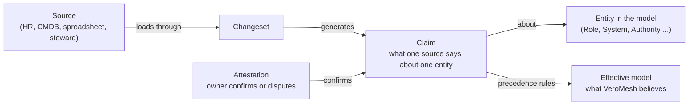
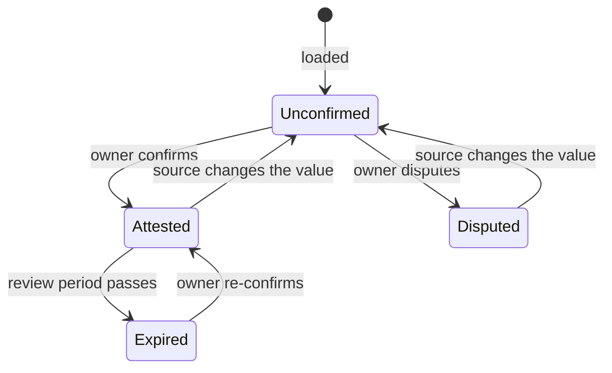

# Provenance model

Status: **built and merged** (PR #5, 7 November 2026), following the review decisions of 6 November 2026 at the end. Code: `service/src/veromesh/provenance.py`; vocabulary and rules: `ontology/veromesh-prov.ttl`, `ontology/shapes/veromesh-prov-shapes.ttl`.

Every fact in the organizational model must answer four questions: **who says so**, **since when**, **for what period is it true**, and **has its owner confirmed it**. Agents rely on the answers before acting, and the decision log has to be able to show what was believed, and why, at the moment an agent acted.

## What exists today

- One named graph per source (`https://veromesh.ai/graph/source/<name>`), written only through changesets.
- A provenance graph records, per source, the changeset that last wrote it, when, by which connector, from which file.
- The model is the **union** of all source graphs. When two sources disagree (HR and a spreadsheet name different managers), both values are in the model and validation reports a violation.

Gaps: no per-fact times, no validity period other than a delegation's own dates, no attestation, no history (a `replace` load overwrites the previous state), no rule for which source wins.

## The model

**Claim.** What one source says about one entity: the field values it asserts, plus

| Property | Meaning | Where it comes from |
| --- | --- | --- |
| source | which source asserted it | the changeset |
| changeset | the load that brought it in | the changeset |
| observed at | when the source system last stated it (transaction time) | the connector, from the record's own timestamp where the source has one; otherwise commit time |
| valid from / valid until | when it is true in the world (valid time); open-ended by default | the connector or the person entering it |
| values | the asserted field values, canonical form, and their hash | the load |
| superseded at | when a later claim from the same source replaced it | set on the next load |

One claim per entity per source, not per field or per triple: it matches how sources deliver data (a worker record, a CMDB item) and keeps the store small. Field-level detail lives in the values, so attestation and conflicts can still be per field.

**Attestation.** A person, acting in a role, confirms or disputes a claim, for all of its fields or a listed subset. An attestation pins the **hash of the values it confirmed**: if the source later changes those values, the attestation no longer matches and the fact is back to unconfirmed, with no rule to maintain. Each attestation carries who, in which role, when, a verdict (`attested` or `disputed`), an optional note, and an expiry. It is also appended to the decision log's hash chain before the model sees it, so the attestations the model relies on can be checked against a tamper-evident record (`GET /api/v1/attestations/verify`; `service/README.md`, "Attestations on the chain").

**Status of a fact**, derived rather than stored:

**Source.** Registered once, with a **category** (`hr`, `iam`, `cmdb`, `erp`, `catalog`, `governance`, `ea` (enterprise architecture: the capability map), `spreadsheet`, `steward`, and `ended` for the system source below), an owner role and a description. Precedence is stated in terms of categories, so a customer's Workday and another customer's SAP SuccessFactors behave the same way. Steward corrections made in the review screen form their own source, `steward`.

**Changeset** stays as it is; it becomes a `prov:Activity` that generated its claims.

Standards: Claim is a `prov:Entity`, Attestation and Changeset are `prov:Activity`, Source is a `prov:SoftwareAgent`, attesters are the model's own Person and Role. Times use `prov:generatedAtTime` / `prov:invalidatedAtTime` where they mean the same thing.

## Which value wins: the effective model

For each entity and field, VeroMesh picks one source's values:

1. Disputed claims are set aside.
2. The highest-ranked source category for that field wins. The field's **domain** decides the order: its authoritative categories, then its evidence, then the rest (`GET /api/v1/domains`). Fields no domain covers use the type's ranking below.
3. A tie goes to the most recently observed claim.

**Domains** (source weighting, decided 23 November 2026). Every field belongs to a domain, the question it answers. Each domain names the categories that decide it (authoritative) and those that support it (evidence). The defaults:

| Domain | Question | Authoritative | Evidence | Covers |
| --- | --- | --- | --- | --- |
| employment | Is this person employed? | hr (contractors: iam) | iam, erp, cmdb, spreadsheet | A person's name, employee ID, email; whether they are employed (the decision check) |
| organization | Whom do they report to, what job role? | hr | iam, spreadsheet | Reports to, roles filled (combined across sources), role names and definitions |
| access | Can they sign in, and to what? | iam | hr, spreadsheet | An agent's sign-in and principal |
| authority-granted | What does policy grant? | governance | hr, spreadsheet | Policies |
| authority-in-force | What limit does the workflow enforce? | erp, then governance | iam, hr, spreadsheet | Authorities and co-approvals: the authority closest to the decision decides; a different granted value is a conflict (out of sync) |
| ai-approval | Which agents may run, for what? | governance | spreadsheet | AI use cases; the actions an agent performs |
| systems | Which systems exist, who owns them? | cmdb | catalog, spreadsheet | Systems |
| capabilities | Which business capabilities are there, how do they nest, and which role owns each? | ea | governance, spreadsheet | Capabilities' names, definitions, parents and owner roles (decided 25 November 2026) |
| objectives | Which objectives are there, how do they cascade, and which role owns each? | hr | governance, spreadsheet | Objectives' names, definitions, owner roles, levels and parents (Workday goals); priorities and conflicts stay with the workbook |
| data-meaning | What does this data mean? | catalog, steward | spreadsheet | Data elements' and products' definitions, owners, sensitivity |

**Roles filled are combined** across live sources: HR's job roles and the identity system's or the workbook's approval roles both count, instead of one replacing the other. An organization changes any domain with `PUT /api/v1/domains/{name}` (administrators; only the keys given: `authoritative`, `evidence`, `contractors`, `union`, `fields`) and returns it to the default with `DELETE`. Each change is appended to the decision log's hash chain (kind `configuration`), and the effective model is rebuilt.

**Derived sources.** A source can declare that it takes a domain from another (`PUT /api/v1/sources/{name}` with `derivedFrom`, for example an AP workflow whose limits are copied from Workday levels: `{"authority-in-force": "workday"}`). It is not independent evidence: where the two differ, the findings report **out of sync** to the derived source's owner.

**Findings** (`GET /api/v1/findings`, filters `kind`, `severity`, `ownerRole`, `source`). What needs someone's attention, each routed to an owner role (the source's registered owner) and the people who fill it today:

| Kind | Severity | When |
| --- | --- | --- |
| access-without-employment | high | No HR source lists the person, yet an `iam` or `erp` source still holds them (a leaver's account or ERP role). Contractors are not findings |
| employed-without-access | info | HR lists them, and the identity system holds no enabled account |
| out-of-sync | medium | Two sources that both decide a domain state different values (the AP workflow against the governance workbook), or a derived source no longer matches its origin. The value in force is the winner's |
| ended-reference | medium | Someone their source dropped is still named by another entity (a leaver still named as a manager) |
| domain-without-authority | info | Facts in a domain, and no registered source in a category that decides it |
| owner-has-left | high | Everyone who fills an owner role of something (a system's business or technical owner, a KPI's, a data product's) has left: HR no longer lists them while another source still names them |
| capability-degraded | high | A KPI that shows a capability's health is past its threshold; to the capability's owner |
| objective-conflict-unsettled | medium | Two objectives conflict, neither has priority and no parent objective's owner settles it; to both owners |
| reported by connectors | as reported | For example the ERP connector's purchase orders their buyer approved, and invoices approved above the approver's limit or without a co-approver (`PUT /api/v1/findings/reported/{source}`, each run replacing the last) |

| Type | Default ranking, for fields no domain covers |
| --- | --- |
| People, reporting lines, roles filled | hr > iam > spreadsheet |
| Roles | hr > spreadsheet |
| Systems | cmdb > catalog > spreadsheet |
| Delegated authority | erp > iam > spreadsheet |
| Approved AI use cases | governance > spreadsheet |
| Capabilities | ea > governance > spreadsheet |
| Objectives | hr > governance > spreadsheet |
| Everything else | spreadsheet (the model's own home today) |

**Steward corrections** are configured per field (decision 1):

- **Steward wins** where the system of record is often incomplete or is not where the business decides: owner and steward roles, criticality, classification and data category, descriptions and definitions, links between business entities (capability served, KPIs measured, data product inputs). The correction takes effect at once; the disagreement stays listed as a conflict until the source is fixed.
- **Source wins** where a system of record is legally or operationally authoritative: a person's name, employee ID, email, reporting line and roles filled (HR); authority amounts, currencies and dates (ERP, IAM); system identifiers and lifecycle state (CMDB); every field of an approved AI use case (the governance board's register: board decisions are disputed, not overruled). A steward can dispute these, which flags them and notifies the source owner, but the value changes only when the source changes.
- Customers can flip any field.

**Ended entities** (issue #67). A load that drops something another source still refers to is not refused. A person who leaves HR, while a stale workbook still says an agent acts for them, is the usual case. The dropped entity is kept as a minimal record (its type, name and the fields it must have, no references) in the system source `ended`, category `ended`, ranked below every other source and never `hr`. The load goes through, and each reference becomes a warning on the changeset: "No longer in 'entra'; kept as ended because agents 'InvoiceAssistant' (actsFor) still refers to it". A violation that the ending causes on the referring entity is reported as a warning too, for that source's owner, and does not refuse the source that dropped it. Because `ended` is never HR, the decision check treats the person as no longer employed. Validation (`--dry-run`) gives the same answer as the commit.

**The proposal step** (step 6a; the whitepaper takes precedence: the model is published, not overwritten). A change from any source to an accountability fact does not enter the effective model at once. These facts are: who a person reports to, the roles they fill, who holds an authority and how far it goes (holder, actions, capability, limit, currency, delegator, parent), a co-approval's approver and threshold, and the person an agent acts for. The change is a **proposal**: the value in force stays until the change is attested, and a dispute keeps it. Three rules keep this safe and quiet:

- **Narrowing takes effect at once.** A role or action removed, a limit or co-approval threshold lowered, a holder removed: an agent never keeps authority while a revocation waits. A list that both gains and loses keeps only what it had and still has (Lee loses two roles now; the new one waits).
- **New entities are not changes.** A new hire's first manager, or a new authority, is in force at once. The step applies to what a source said before and now says differently.
- **Accepting must leave the model valid.** Attesting a proposal that would break a rule (a limit above its parent authority's) is refused with the violations, as the load would have been, and the proposal keeps waiting.

`GET /api/v1/proposals` lists what waits: the value proposed, the value in force, the proposing source, and who is asked to attest it. Those are the proposed manager and the manager in force for a reporting line, the person's manager for roles, the holder of the parent authority (a role's fillers, an agent's principal) for an authority, and the proposed principal for an agent. The proposing source's owner role is also asked. `POST /api/v1/proposals/{type}/{id}/{field}` with `attested` or `disputed` settles it; the attestation goes on the decision log's hash chain like any other. Each waiting change is also an `accountability-change-proposed` finding, routed to those people. `VEROMESH_PROPOSALS=off` turns the step off.

**Fidelity** (step 7a; step 3 of the source-weighting design, `src/veromesh/fidelity.py`). Fidelity is how well this organization keeps a source. It is measured per registered source, per domain the source decides, over the last 90 days, and gives a band: high, medium or low. The signals are:

- **Corrections:** the share of its facts that owners disputed or stewards corrected.
- **Lateness:** how many days after a change took effect the source reported it. Examples are an end date that had passed when the source reported it, and a new effective date that had passed when the source last reported.
- **Gaps:** fields decisions need that are missing, such as a person's employee ID or manager, a system's owner, or an authority's holder.
- **Contradicted:** evidence sources disagree with it. This lowers a source to medium at most; a correction or dispute is what shows the evidence was right.
- **Loads:** refused loads, and days since the last good one.

Until a source has 20 facts in the domain and a committed load, it uses the **declared** rating given when it was registered (`fidelity`: high, medium or low, which can come from the maturity assessment). With none declared, it counts as high. `GET /api/v1/fidelity` gives the bands, the signals and, signal by signal, the reasons; `GET /api/v1/sources` shows each band; the steward screen's **Sources** tab shows both.

Fidelity never makes an unsuited source authoritative. It changes how far VeroMesh relies on the authoritative one:

- **Low:** the decision check consults the source's owner role rather than allowing, with the reasons, whenever it relies on the source: HR for the principal's employment, or the source of the authority in force. With no owner role it refuses. Every decision records the bands it relied on in `basis.fidelity`.
- **Medium and low:** attestations of the source's facts expire sooner, at half and a quarter of the cycle.
- **Lateness margin:** when an identity system removes an employed person's access and their HR source usually reports changes late, an `access-removed-hr-may-be-late` finding goes to HR's owner. The person's agents already consult the next authority up.
- **Ties:** between two sources of one category, the declared rating breaks a tie before recency does.

**Versioned publish.** Every change to the effective model (a commit, a single-entity write, a steward correction, a settled proposal) is a publish. It is recorded on the decision log as a `publish` entry with the model version it made, the source and the changeset, and the write's response carries `modelVersion`. Every decision quotes the version it was made on (`basis.modelVersion`). `GET /api/v1/model/versions` lists the publishes. An auditor goes from any decision to the publish behind it, and reads the model as it was then with `asOf`.

The result is materialized in an **effective graph** (`https://veromesh.ai/graph/effective`), recomputed for the touched entities on every commit and attestation. Validation, impact queries, the agent gateway and DataHub publishing read the effective graph instead of the union, so a disagreement between sources is no longer a model violation. Instead it is a **conflict**: two sources assert different non-empty values for the same field. Conflicts are listed by the API and, from Phase 2, routed to the entity's owner.

## Time and history

Two times on every claim:
- **observed at**: when we learned it (bitemporal transaction time);
- **valid from / until**: when it holds in the world.

Superseded claims are kept indefinitely, not overwritten (decision 2). That allows reading the model **as of** a date: for each source, the claim that was current then and valid then, with the same precedence. The decision log records the claim IDs an agent's check relied on, so an audit can replay exactly what was believed.

A delegation's own dates (`validFrom`, `validUntil` on Delegated authority) stay in the model: they are a property of the grant, not of what a source said about it.

## API

Additions to `/api/v1` (existing endpoints unchanged):

| Endpoint | Purpose |
| --- | --- |
| `GET /{type}/{id}/provenance` | Why we believe this: per field, the effective value, the winning claim (source, observed, valid, status) and any other claims |
| `GET /{type}/{id}?asOf=2026-10-01` | The entity as it was believed on a date |
| `POST /{type}/{id}/attestations` | Confirm or dispute: `{fields?, verdict, note?, role}`, as the signed-in person (who must fill `role`) |
| `POST /{type}/{id}/corrections` | Steward correction: new values, recorded as a claim from the `steward` source and attested in the same step |
| `GET /attestations?status=unconfirmed&type=&ownerRole=` | Review queue, shown on the steward screen (`/steward`, Facts to confirm) |
| `POST /meetings`, `GET /meetings`, `GET /meetings/{id}` | Meetings as evidence for attestations recorded in them (stewards); a meeting lists what was recorded in it and where each stands |
| `POST /meetings/preread` | For each person attending, the facts waiting for them |
| `POST /meetings/{id}/attestations` | Record what owners confirmed in the meeting: `{items: [{type, id, owner, role, fields?, note?}]}` |
| `GET`/`PUT /notify/settings`, `POST /notify/run` | How owners are told (administrators): channels in order, what notices show, the reminder day; send what is due now |
| `POST /teams/messages` | The Teams bot's endpoint, called by Microsoft's Bot Framework with its own token |
| `GET /meetings/recorded?person=` | Attestations recorded for you (stewards: for anyone), open, confirmed, disputed or standing |
| `GET /authorities/{id}/confirmation` | Whether an agent may rely on an authority: every fact behind it attested and current (decision 3), with the reasons when not |
| `GET /governance` | The rankings, steward-correction policy and cadence in force |
| `POST /effective/rebuild` | Recompute the effective model, e.g. after valid-until dates pass |
| `GET /conflicts?type=` | Fields where sources disagree |
| `PUT /sources/{name}` | Register a source: category, owner role, description |

Changeset items gain optional `observedAt`, `validFrom`, `validUntil`. The connector SDK's `Item` carries them, and mapping files can fill them from source columns (for example `observedAt: "{Last Modified}"`). The spreadsheet keeps working without them.

**Attesting in meetings** (gap G9). Owners do not need to visit a screen: a steward records, in a meeting the owners already hold (a monthly review, a governance board), the facts each owner confirmed there. `POST /meetings` creates the meeting (name, date, a link to its minutes or recording, the chair) and puts it on the decision log's hash chain as a `meeting` entry; `POST /meetings/preread` lists, for each person attending, the facts waiting for them in the roles they fill (unconfirmed or expired), to read before the meeting. `POST /meetings/{id}/attestations` then records the ticked facts for their owners: each attestation is the owner's (`person`), made in a role they fill, with `recordedBy` (the signed-in steward), `meeting` and `objectionUntil` (five business days, Monday to Friday) beside it, all on the hash chain and checked by `GET /attestations/verify`. All items are checked before any is written; a steward cannot record for themselves, and a role the owner does not fill is refused. A recorded attestation counts at once. The owner sees it under **Recorded for you in meetings** on the steward screen (`GET /meetings/recorded`), and can confirm it or object, which is an ordinary dispute: it stands disputed as any other. Each one stands `open` until the window closes, then `stands`; `confirmed` once the owner attests it themselves, `disputed` once they object. **Telling the owner.** After each recording, and every hour, VeroMesh tells each owner what was recorded for them, by the first channel set on the install that reaches them (`notify.py`). **Email** goes through the install's mail adapter (the one the usage report uses), to the person's email in the model, with a link to the steward screen (`VEROMESH_PUBLIC_URL`). **Teams** is an Adaptive Card from the VeroMesh bot with Confirm and Object for each fact ([deploy/teams/README.md](../deploy/teams/README.md)). One reminder follows after three business days if the owner has neither confirmed nor objected. Notices show the values recorded or only which facts. Personal details (an email, an employee ID, a reporting line) are never shown. Administrators set the channels, what notices show and the reminder day on Administration > Notices (`GET`/`PUT /notify/settings`, logged as a `configuration` entry). Every notice sent is a `notice` entry on the hash chain, with the person, the meeting, the channel and the attestations it covered: evidence that the owner was told and could object. A notice that cannot be sent is retried at the next run, and the Meetings tab shows why it was not sent.

With sign-in on, the attester is the signed-in person (matched to the model by email or employee ID; `service/README.md`, "Attesting as yourself"), who must fill the role they act in. Owners attest their own facts without the VeroMesh steward role: acting in one of the entity's owner or steward roles is enough. A steward acting in another role may still attest, with a warning. With sign-in off (development), the request names the attester.

## Validation rules (SHACL)

- Every claim has exactly one source, changeset, observed time and value hash; valid until is not before valid from.
- Every attestation names a person, a role, a verdict, a time and a pinned hash. One recorded by someone else also names the meeting and the end of the objection window.
- Warning: the attester does not hold the entity's owner or steward role.
- Unconfirmed facts are usable everywhere and marked as such, except in an agent's authority check (decision 3): there the delegated authority, the role it hangs on, the person filling the role and the ownership of the affected KPIs must each be attested and not expired, or the check fails with the reason. Elsewhere this shows as a warning.

## Size

One claim per entity per source, about ten triples each. 50,000 people from two sources plus 5,000 systems is about 110,000 claims, around 1.1 million triples, plus history. That is well within Fuseki TDB2 on one node; the Phase 0 load test includes it.

## What changes for existing data

A migration creates one claim per entity per existing source, observed at that source's last commit, unconfirmed, and builds the effective graph. Sources get the category `spreadsheet` until registered otherwise. Contract snapshots change for the new routes; existing endpoints and the workbook format do not.

## Build split

| Built in PR #5 | Phase 2, with the CMDB connector |
| --- | --- |
| Vocabulary and validation rules; claims and history on every commit; observed and valid times through the API and connectors; attestations and the derived status; the provenance, as-of, attestation, correction, conflict and source endpoints; default precedence and the effective graph; migration; tests and contract snapshots | Customer-configurable precedence rules; entity matching across sources (same person under employee ID and email, with confidence and manual review); conflicts routed to owners; attestation campaigns and reminders |

## Implementation notes

- The effective graph is recomputed from the recorded claims on every commit, attestation and source registration. Facts outside their valid period drop out at the next recomputation; `POST /api/v1/effective/rebuild` forces one (run it daily, or after a batch of date changes).
- Validation checks the effective model as it would be after the change, with valid periods ignored: a delegation that has expired is still a structurally valid fact.
- Attestations are per field: each pins the hash of the value it covered, for one source. A change to another field leaves it standing.
- Decimals are compared in one canonical form (50000.00 and 50000 are the same value), so an unchanged reload records no new claims.
- Built alongside: re-saving an entity in merge mode no longer drops links that belong to other entities (renaming a role used to remove the authorities it holds).

## Review decisions (6 November 2026)

| # | Question | Decision |
| --- | --- | --- |
| 1 | A steward corrects a value that the authoritative system still states differently | Configured per field: steward wins for ownership, classification, definitions and business links; the source wins for HR identity, authority amounts and dates, and CMDB identifiers; customers can flip any field |
| 2 | How much history to keep | All of it, for as-of reads and audit replay |
| 3 | Can unconfirmed facts be used? | Yes, marked as unconfirmed, except in an agent's authority check, where authority, role, person and KPI ownership must be attested and current |
| 4 | How often facts must be re-confirmed | Per type: delegated authority 90 days; people, roles and ownership 180 days; everything else 365 days; customers can change them |

The per-field defaults for decision 1 shipped as proposed; customers can flip any field.
