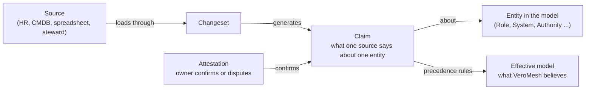
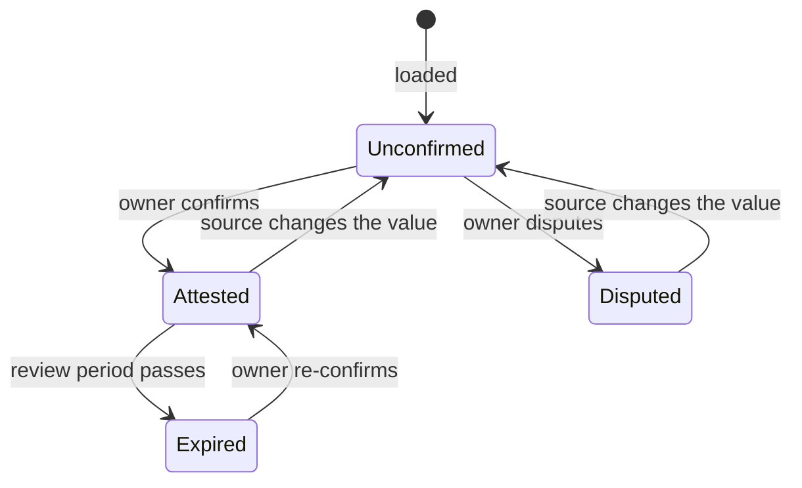

# Provenance model

Status: **built and merged** (PR #5, 7 November 2026), following the review decisions of 6 November 2026 at the end. Code: `service/src/veromesh/provenance.py`; vocabulary and rules: `ontology/veromesh-prov.ttl`, `ontology/shapes/veromesh-prov-shapes.ttl`.

Every fact in the organizational model must answer four questions: **who says so**, **since when**, **for what period is it true**, and **has its owner confirmed it**. Agents rely on the answers before acting, and the decision log has to be able to show what was believed, and why, at the moment an agent acted.

## What exists today

- One named graph per source (`https://veromesh.ai/graph/source/<name>`), written only through changesets.
- A provenance graph records, per source, the changeset that last wrote it, when, by which connector, from which file.
- The model is the **union** of all source graphs. When two sources disagree (HR and a spreadsheet name different managers), both values are in the model and validation reports a violation.

Gaps: no per-fact times, no validity period other than a delegation's own dates, no attestation, no history (a `replace` load overwrites the previous state), no rule for which source wins.

## The model

**Claim.** What one source says about one entity: the field values it asserts, plus

| Property | Meaning | Where it comes from |
| --- | --- | --- |
| source | which source asserted it | the changeset |
| changeset | the load that brought it in | the changeset |
| observed at | when the source system last stated it (transaction time) | the connector, from the record's own timestamp where the source has one; otherwise commit time |
| valid from / valid until | when it is true in the world (valid time); open-ended by default | the connector or the person entering it |
| values | the asserted field values, canonical form, and their hash | the load |
| superseded at | when a later claim from the same source replaced it | set on the next load |

One claim per entity per source, not per field or per triple: it matches how sources deliver data (a worker record, a CMDB item) and keeps the store small. Field-level detail lives in the values, so attestation and conflicts can still be per field.

**Attestation.** A person, acting in a role, confirms or disputes a claim, for all of its fields or a listed subset. An attestation pins the **hash of the values it confirmed**: if the source later changes those values, the attestation no longer matches and the fact is back to unconfirmed, with no rule to maintain. Each attestation carries who, in which role, when, a verdict (`attested` or `disputed`), an optional note, and an expiry.

**Status of a fact**, derived rather than stored:

**Source.** Registered once, with a **category** (`hr`, `iam`, `cmdb`, `erp`, `catalog`, `spreadsheet`, `steward`), an owner role and a description. Precedence is stated in terms of categories, so a customer's Workday and another customer's SAP SuccessFactors behave the same way. Steward corrections made in the review screen form their own source, `steward`.

**Changeset** stays as it is; it becomes a `prov:Activity` that generated its claims.

Standards: Claim is a `prov:Entity`, Attestation and Changeset are `prov:Activity`, Source is a `prov:SoftwareAgent`, attesters are the model's own Person and Role. Times use `prov:generatedAtTime` / `prov:invalidatedAtTime` where they mean the same thing.

## Which value wins: the effective model

For each entity and field, VeroMesh picks one source's values:

1. Disputed claims are set aside.
2. The highest-ranked source category for that type and field wins (defaults below; customers adjust them).
3. A tie goes to the most recently observed claim.

| Type | Default ranking |
| --- | --- |
| People, reporting lines, roles filled | hr > iam > spreadsheet |
| Roles | hr > spreadsheet |
| Systems | cmdb > catalog > spreadsheet |
| Delegated authority | erp > iam > spreadsheet |
| Everything else | spreadsheet (the model's own home today) |

**Steward corrections** are configured per field (decision 1):

- **Steward wins** where the system of record is often incomplete or is not where the business decides: owner and steward roles, criticality, classification and data category, descriptions and definitions, links between business entities (capability served, KPIs measured, data product inputs). The correction takes effect at once; the disagreement stays listed as a conflict until the source is fixed.
- **Source wins** where a system of record is legally or operationally authoritative: a person's name, employee ID, email, reporting line and roles filled (HR); authority amounts, currencies and dates (ERP, IAM); system identifiers and lifecycle state (CMDB). A steward can dispute these, which flags them and notifies the source owner, but the value changes only when the source changes.
- Customers can flip any field.

The result is materialized in an **effective graph** (`https://veromesh.ai/graph/effective`), recomputed for the touched entities on every commit and attestation. Validation, impact queries, the agent gateway and DataHub publishing read the effective graph instead of the union, so a disagreement between sources is no longer a model violation. Instead it is a **conflict**: two sources assert different non-empty values for the same field. Conflicts are listed by the API and, from Phase 2, routed to the entity's owner.

## Time and history

Two times on every claim:
- **observed at**: when we learned it (bitemporal transaction time);
- **valid from / until**: when it holds in the world.

Superseded claims are kept indefinitely, not overwritten (decision 2). That allows reading the model **as of** a date: for each source, the claim that was current then and valid then, with the same precedence. The decision log records the claim IDs an agent's check relied on, so an audit can replay exactly what was believed.

A delegation's own dates (`validFrom`, `validUntil` on Delegated authority) stay in the model: they are a property of the grant, not of what a source said about it.

## API

Additions to `/api/v1` (existing endpoints unchanged):

| Endpoint | Purpose |
| --- | --- |
| `GET /{type}/{id}/provenance` | Why we believe this: per field, the effective value, the winning claim (source, observed, valid, status) and any other claims |
| `GET /{type}/{id}?asOf=2026-10-01` | The entity as it was believed on a date |
| `POST /{type}/{id}/attestations` | Confirm or dispute: `{fields?, verdict, note?, attester, role}` |
| `POST /{type}/{id}/corrections` | Steward correction: new values, recorded as a claim from the `steward` source and attested in the same step |
| `GET /attestations?status=unconfirmed&type=&ownerRole=` | Review queue for the steward screen (Phase 1) |
| `GET /authorities/{id}/confirmation` | Whether an agent may rely on an authority: every fact behind it attested and current (decision 3), with the reasons when not |
| `GET /governance` | The rankings, steward-correction policy and cadence in force |
| `POST /effective/rebuild` | Recompute the effective model, e.g. after valid-until dates pass |
| `GET /conflicts?type=` | Fields where sources disagree |
| `PUT /sources/{name}` | Register a source: category, owner role, description |

Changeset items gain optional `observedAt`, `validFrom`, `validUntil`. The connector SDK's `Item` carries them, and mapping files can fill them from source columns (for example `observedAt: "{Last Modified}"`). The spreadsheet keeps working without them.

Attester identity is taken from the request until single sign-on arrives in Phase 1; from then on it comes from the signed-in user, and only holders of the entity's owner or steward role may attest.

## Validation rules (SHACL)

- Every claim has exactly one source, changeset, observed time and value hash; valid until is not before valid from.
- Every attestation names a person, a role, a verdict, a time and a pinned hash.
- Warning: the attester does not hold the entity's owner or steward role.
- Unconfirmed facts are usable everywhere and marked as such, except in an agent's authority check (decision 3): there the delegated authority, the role it hangs on, the person filling the role and the ownership of the affected KPIs must each be attested and not expired, or the check fails with the reason. Elsewhere this shows as a warning.

## Size

One claim per entity per source, about ten triples each. 50,000 people from two sources plus 5,000 systems is about 110,000 claims, around 1.1 million triples, plus history. That is well within Fuseki TDB2 on one node; the Phase 0 load test includes it.

## What changes for existing data

A migration creates one claim per entity per existing source, observed at that source's last commit, unconfirmed, and builds the effective graph. Sources get the category `spreadsheet` until registered otherwise. Contract snapshots change for the new routes; existing endpoints and the workbook format do not.

## Build split

| Built in PR #5 | Phase 2, with the CMDB connector |
| --- | --- |
| Vocabulary and validation rules; claims and history on every commit; observed and valid times through the API and connectors; attestations and the derived status; the provenance, as-of, attestation, correction, conflict and source endpoints; default precedence and the effective graph; migration; tests and contract snapshots | Customer-configurable precedence rules; entity matching across sources (same person under employee ID and email, with confidence and manual review); conflicts routed to owners; attestation campaigns and reminders |

## Implementation notes

- The effective graph is recomputed from the recorded claims on every commit, attestation and source registration. Facts outside their valid period drop out at the next recomputation; `POST /api/v1/effective/rebuild` forces one (run it daily, or after a batch of date changes).
- Validation checks the effective model as it would be after the change, with valid periods ignored: a delegation that has expired is still a structurally valid fact.
- Attestations are per field: each pins the hash of the value it covered, for one source. A change to another field leaves it standing.
- Decimals are compared in one canonical form (50000.00 and 50000 are the same value), so an unchanged reload records no new claims.
- Built alongside: re-saving an entity in merge mode no longer drops links that belong to other entities (renaming a role used to remove the authorities it holds).

## Review decisions (6 November 2026)

| # | Question | Decision |
| --- | --- | --- |
| 1 | A steward corrects a value that the authoritative system still states differently | Configured per field: steward wins for ownership, classification, definitions and business links; the source wins for HR identity, authority amounts and dates, and CMDB identifiers; customers can flip any field |
| 2 | How much history to keep | All of it, for as-of reads and audit replay |
| 3 | Can unconfirmed facts be used? | Yes, marked as unconfirmed, except in an agent's authority check, where authority, role, person and KPI ownership must be attested and current |
| 4 | How often facts must be re-confirmed | Per type: delegated authority 90 days; people, roles and ownership 180 days; everything else 365 days; customers can change them |

The per-field defaults for decision 1 shipped as proposed; customers can flip any field.
